# My App

CO2 and Greenhouse Gas Emissions Viewer

## Performance Profiling

Initial profiling was performed using **React DevTools Profiler**.

**Tested interactions:**
- Changing a year
- Changing sorting attribute
- Changing sorting direction
- Searching for a country
- Adding/removing columns

## Before optimization

### Changing a year (User selects a different year from the input; table highlights updated values)
- **Committed at: 1.6s**
- **Render Duration: 81ms**
### - Screenshots: 
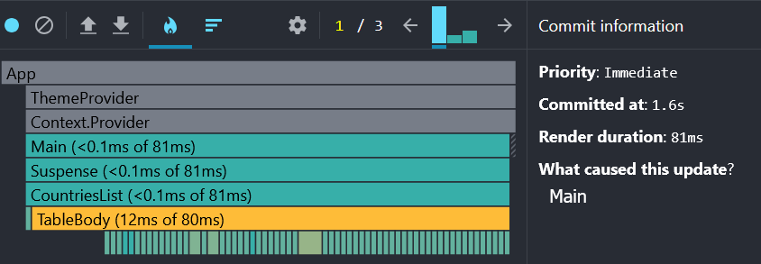
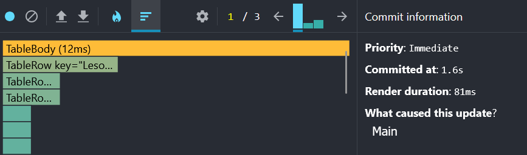

### Changing sorting attribute (User changes sortKey from `name` to `population`)
- **Committed at: 1.9s**
- **Render Duration: 94ms**
### - Screenshots: 
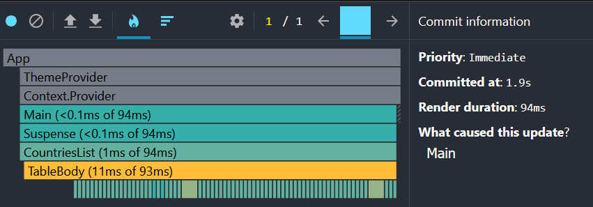
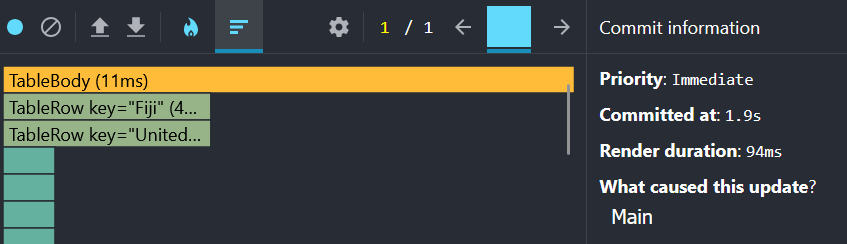

### Changing sorting direction (User changes sortOrder from `asc` to `desc`)
- **Committed at: 2.2s**
- **Render Duration: 93ms**
### - Screenshots: 
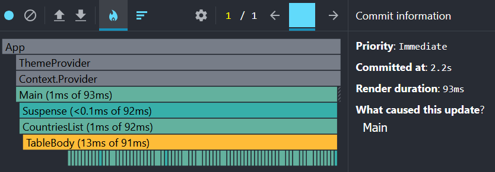
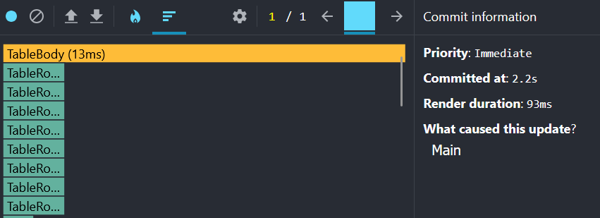

### Searching for a country (User types a country name in the search bar; table filters results)
- **Committed at: 1.5s**
- **Render Duration: 14ms**
- **LayoutEffects: 1ms**
### - Screenshots: 
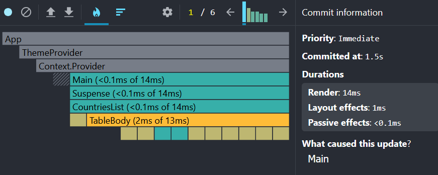
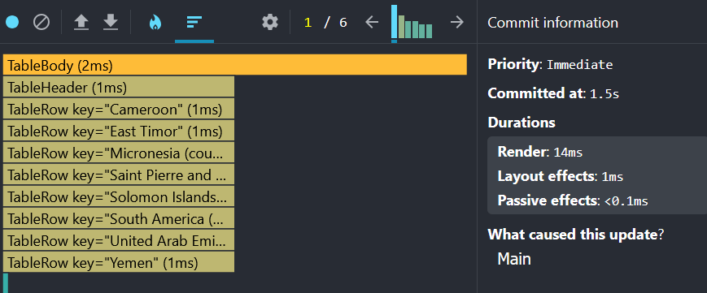

### Adding table columns (User opens modal and selects additional columns)
- **Committed at: 0.9s**
- **Render Duration: 4ms**
- **LayoutEffects: 2ms**
### - Screenshots: 
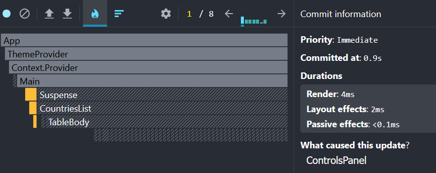
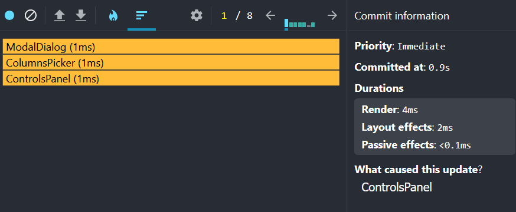

### Removing table columns (User opens modal and deselects additional columns)
- **Committed at: 1.4s**
- **Render Duration: 4ms**
- **LayoutEffects: <0.1ms**
### - Screenshots: 
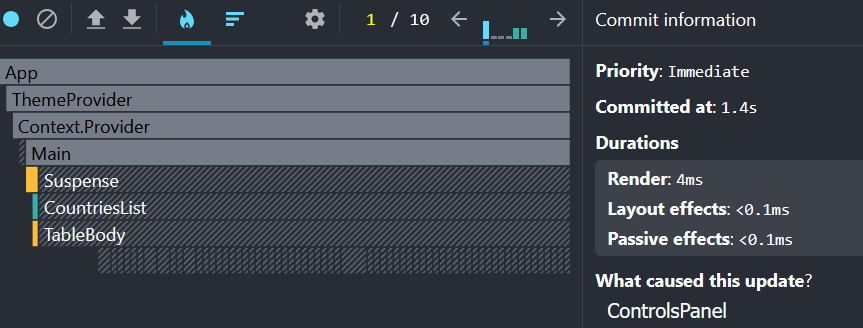
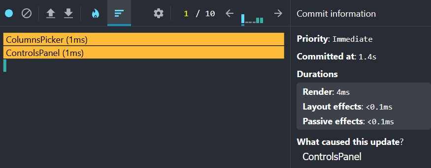

## After optimization

### Changing a year (User selects a different year from the input; table highlights updated values)
- **Committed at: 1.2s**
- **Render Duration: 57ms**
### - Screenshots: 
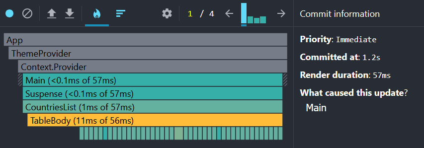
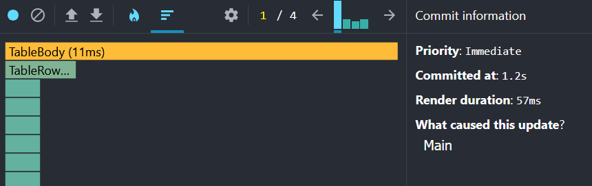

### Changing sorting attribute (User changes sortKey from `name` to `population`)
- **Committed at: 2s**
- **Render Duration: 47ms**
### - Screenshots: 
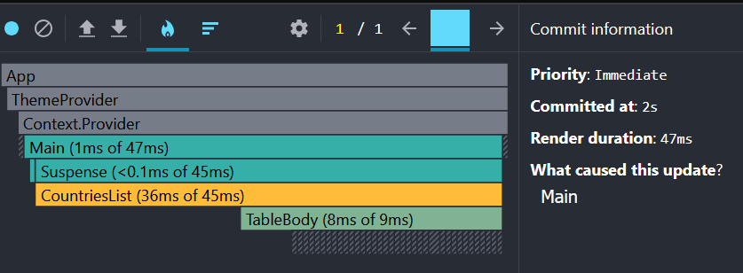
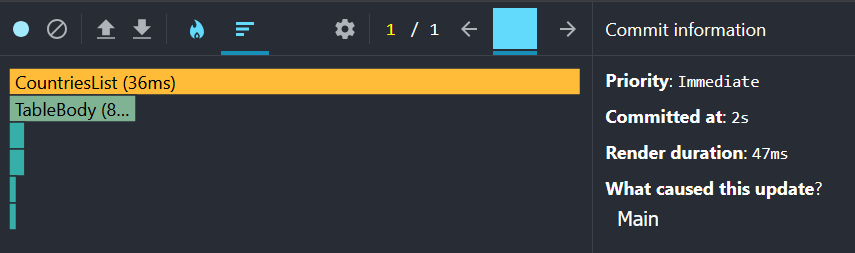

### Changing sorting direction (User changes sortOrder from `asc` to `desc`)
- **Committed at: 1.7s**
- **Render Duration: 48ms**
### - Screenshots: 
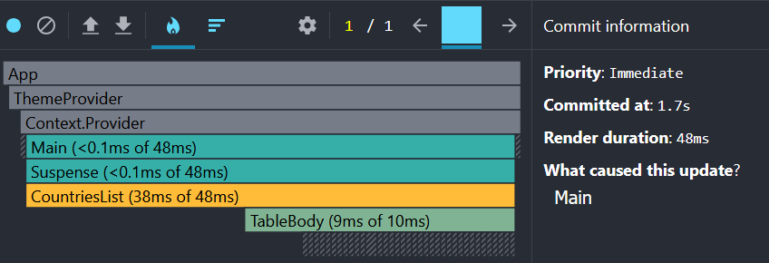
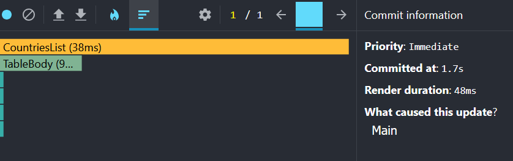

### Searching for a country (User types a country name in the search bar; table filters results)
- **Committed at: 1.6s**
- **Render Duration: 9ms**
- **LayoutEffects: 4ms**
### - Screenshots: 
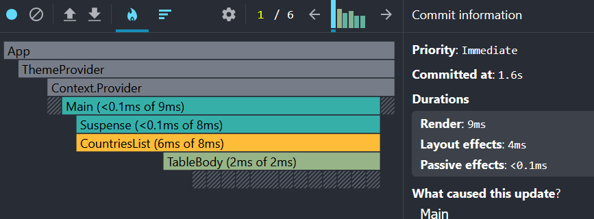
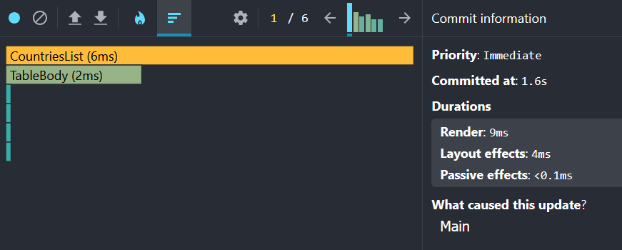

### Adding table columns (User opens modal and selects additional columns)
- **Committed at: 0.8s**
- **Render Duration: 1ms**
- **LayoutEffects: <0.1ms**
### - Screenshots: 
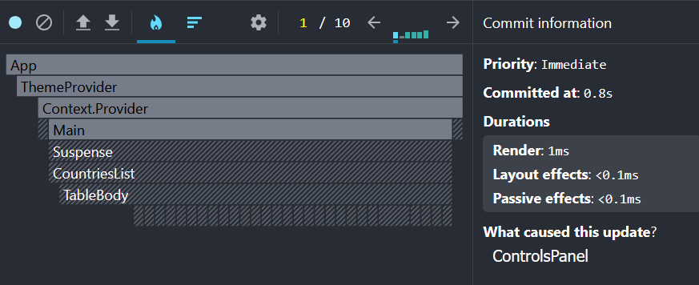
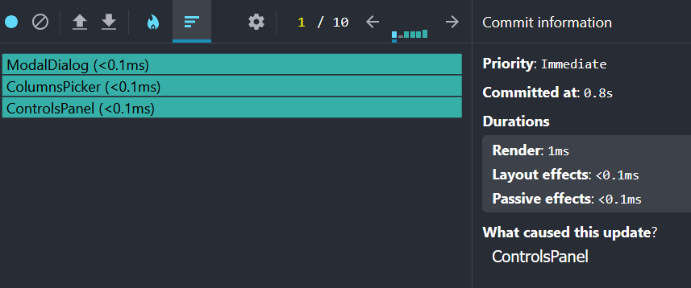

### Removing table columns (User opens modal and deselects additional columns)
- **Committed at: 1.1s**
- **Render Duration: 8ms**
- **LayoutEffects: <0.1ms**
### - Screenshots: 
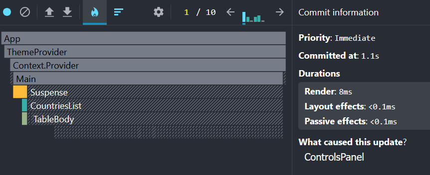
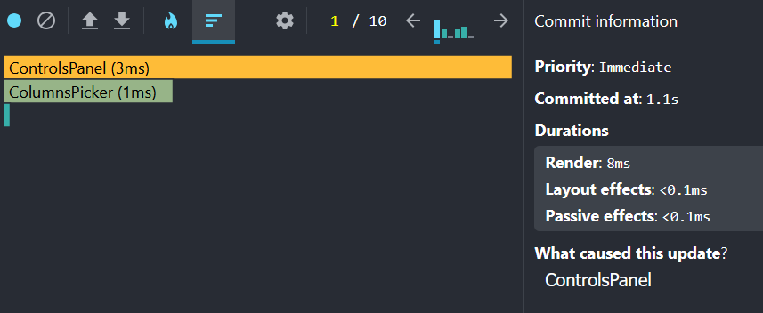

## Analyzing results

### Action taken: 
- Several components were wrapped in memo(TableRow, TableBody, CountriesList, ControlsPanel)
- Objects were memoized with useMemo in TableBody and CountriesList
- useCallback was used to memoize controls panel functions

### Before optimization:
- Large components (TableRow for ~220 countries) re-rendered on almost every interaction
- Sorting and changing the year were the most expensive operations (~94ms)

### After optimization:
- Most components only re-render when necessary
- Render durations decreased by ~30–50ms per interaction
- Searching, adding, or removing columns became nearly instant (<5ms)

### Conclusion: 
- Using `React.memo`, `useMemo`, and `useCallback` increased overall performance of the app for a large database

